[](https://play.google.com/store/apps/details?id=acab.naiveha.subrosa.by.naiveha)
[](https://apt.izzysoft.de/packages/acab.naiveha.subrosa)

# sub rosa by naiveHA

Turn your Android phone into an on-the-go security command center for your hardware keys. Type ultra-secure 
passwords on any computer without touching the keyboard. Program OpenPGP identities on the fly. 
Wipe secrets instantly.

Picture this: you are sitting at a bustling coffee shop, library, or airport gate with surveillance 
cameras overhead and people nearby. You need to log into a 32-character master password, 
your BitLocker/LUKS encrypted drive, a work laptop, or a remote server. Typing it out invites shoulder surfers, 
camera recording, and hardware keyloggers. Leaving that password permanently stored on your 
physical security key means losing your keychain compromises your account.

**With *sub rosa*, you get the best of both worlds:** tap your NFC security key (or plug via USB) to 
your Android phone to load the password or OpenPGP key you need *right now*. Plug the key into *any* PC, 
Mac, server, or kiosk. Touch the gold contact. The hardware key acts as a standard USB keyboard (HID) 
and types your long, complex password in milliseconds. Done with your session? Tap the key to your phone 
again to erase it. If you lose your physical key on the train, it holds **zero data**.

**International Keyboard Layouts Supported**  
  * **US**: space, `\n`, `\t` and `abcdefghijklmnopqrstuvwxyzABCDEFGHIJKLMNOPQRSTUVWXYZ0123456789!"#$%&'`()*+-=,./:;<>?@\\][^_{}|~`  
  * **UK**: space, `\n`, `\t` and `abcdefghijklmnopqrstuvwxyzABCDEFGHIJKLMNOPQRSTUVWXYZ0123456789!@£$%&'`()*+-=,./:;<>?"#][^_{}~¬`  
  * **DE**: space, `\n`, `\t` and `abcdefghijklmnopqrstuvwxyzABCDEFGHIJKLMNOPQRSTUVWXYZ0123456789!"#$%&'()*+-=,./:;<>?^_`§´ÄÖÜßäöü`  
  * **FR**: space, `\n`, `\t` and `abcdefghijklmnopqrstuvwxyzABCDEFGHIJKLMNOPQRSTUVWXYZ0123456789!"$%&'()*+-=,./:;<_£§°²µàçèéù`  
  * **IT**: space, `\n`, `\t` and `abcdefghijklmnopqrstuvwxyzABCDEFGHIJKLMNOPQRSTUVWXYZ0123456789!"#$%&'()*+,-./:;<=>?@\^_`|£§°çèéàìòù`  
  * **MODHEX**: `bcdefghijklnrtuvBCDEFGHIJKLNRTUV`

Picture this: you need to handle high-stakes digital tasks on the move. In the morning, you must sign a 
legally binding contract or authenticate an emergency SSH session into a remote production server. In the 
afternoon, you need to decrypt a confidential, business-critical document received from a business partner. 
Later, as an investigative journalist, activist, or privacy advocate, you need to encrypt a sensitive 
whistleblower document before transmitting it to a news organization.

Keeping these distinct digital identities and private keys permanently stored on a single 
physical key on your keychain is a disaster waiting to happen. If you lose that key on a train or it gets 
searched at a border crossing, all your compartmentalized personas are exposed. Carrying half a dozen separate, 
expensive hardware tokens everywhere is clunky and impractical.

**With *sub rosa*, your hardware key becomes a disposable, on-demand cryptographic badge:** manage your 
OpenPGP identities safely in apps like OpenKeychain or PGPony on your phone. When a specific task arises, tap your YubiKey, Nitrokey, or Librem Key via NFC 
or USB to flash the exact Signing, Decryption, or Authentication subkeys (RSA, Ed25519, X25519) you need for 
that single moment. Sign the document, decrypt the partner’s message, or encrypt the whistleblower report. 
Once you're done, wipe the hardware key clean with another tap. If anyone picks up your security key later, 
it holds **zero data**. One physical key, infinite ephemeral identities.

**On-the-Go OpenPGP Management** Program OpenPGP keys (RSA, NIST P-curves, Brainpool, Ed25519, X25519) 
onto YubiKey, Nitrokey 3, Nitrokey Pro 2, Nitrokey Storage 2, and Librem Key directly from Android. 
Sign electronic documents, decrypt messages, or authenticate via SSH anywhere.

**Field PIN Management & Firmware Updates** Change or unblock User and Admin PINs on the fly, and 
update LPC55-based Nitrokey 3 firmware directly from your phone.

**Air-Gapped & Ephemeral by Design** Compartmentalize your digital personas. Program a key, sign a 
document or authenticate via SSH, and wipe the key clean when finished.

*sub rosa* has its roots in the YubiKit library provided by Yubico.

# How does *sub rosa* support various hardware security keys?

<table>
	<tr>
		<td height="34"><br></td>
		<td></td>
		<td colspan="2" align="center">YubiKey</td>
		<td colspan="2" align="center">Nitrokey 3</td>
        <td align="center">Nitrokey Pro 2</td>
        <td align="center">Nitrokey Storage 2</td>
        <td align="center">Librem Key</td>
	</tr>
	<tr>
		<td></td>
		<td></td>
		<td align="center">USB</td>
		<td align="center">NFC</td>
		<td align="center">USB</td>
		<td align="center">NFC</td>
        <td align="center">USB</td>
        <td align="center">USB</td>
        <td align="center">USB</td>
	</tr>
	<tr>
		<td align="center">Static password</td>
		<td align="center">Write</td>
		<td align="center">✅</td>
		<td align="center">✅</td>
		<td align="center">❌</td>
		<td align="center">❌</td>
        <td align="center">❌</td>
        <td align="center">❌</td>
        <td align="center">❌</td>
	</tr>
	<tr>
		<td align="center"></td>
		<td align="center">Read</td>
		<td align="center">✅</td>
		<td align="center">✅</td>
		<td align="center">❌</td>
		<td align="center">❌</td>
        <td align="center">❌</td>
        <td align="center">❌</td>
        <td align="center">❌</td>
	</tr>
	<tr>
		<td align="center"></td>
		<td align="center">Wipe</td>
		<td align="center">✅</td>
		<td align="center">✅</td>
		<td align="center">❌</td>
		<td align="center">❌</td>
        <td align="center">❌</td>
        <td align="center">❌</td>
        <td align="center">❌</td>
	</tr>
	<tr>
		<td align="center">OpenPGP</td>
		<td align="center">Write</td>
		<td align="center">✅</td>
		<td align="center">✅</td>
		<td align="center">✅</td>
		<td align="center">❌</td>
        <td align="center">✅</td>
        <td align="center">✅</td>
        <td align="center">✅</td>
	</tr>
	<tr>
		<td align="center"></td>
		<td align="center">Read</td>
		<td align="center">✅</td>
		<td align="center">✅</td>
		<td align="center">✅</td>
		<td align="center">❌</td>
        <td align="center">✅</td>
        <td align="center">✅</td>
        <td align="center">✅</td>
	</tr>
	<tr>
		<td align="center"></td>
		<td align="center">Wipe</td>
		<td align="center">✅</td>
		<td align="center">✅</td>
		<td align="center">✅</td>
		<td align="center">❌</td>
        <td align="center">✅</td>
        <td align="center">✅</td>
        <td align="center">✅</td>
	</tr>
	<tr>
		<td align="center"></td>
		<td align="center">Change User PIN</td>
		<td align="center">✅</td>
		<td align="center">✅</td>
		<td align="center">✅</td>
		<td align="center">❌</td>
        <td align="center">✅</td>
        <td align="center">✅</td>
        <td align="center">✅</td>
	</tr>
	<tr>
		<td align="center"></td>
		<td align="center">Reset User PIN</td>
		<td align="center">✅</td>
		<td align="center">✅</td>
		<td align="center">✅</td>
		<td align="center">❌</td>
        <td align="center">✅</td>
        <td align="center">✅</td>
        <td align="center">✅</td>
	</tr>
	<tr>
		<td align="center"></td>
		<td align="center">Change Admin PIN</td>
		<td align="center">✅</td>
		<td align="center">✅</td>
		<td align="center">✅</td>
		<td align="center">❌</td>
        <td align="center">✅</td>
        <td align="center">✅</td>
        <td align="center">✅</td>
	</tr>
</table>

<table>
    <tr> 
        <td>Supported cryptographic algorithms</td> 
        <td align="center">YubiKey</td> 
        <td align="center">Nitrokey 3</td> 
        <td align="center">Nitrokey Pro 2</td> 
        <td align="center">Nitrokey Storage 2</td>
        <td align="center">Librem Key</td> 
    </tr>
    <tr> 
        <td>RSA / 2048</td> 
        <td align="center">✅</td> 
        <td align="center">✅</td> 
        <td align="center">✅</td> 
        <td align="center">✅</td>
        <td align="center">✅</td> 
    </tr> 
    <tr> 
        <td>RSA / 3072</td> 
        <td align="center">✅</td> 
        <td align="center">✅</td> 
        <td align="center">✅</td> 
        <td align="center">✅</td> 
        <td align="center">✅</td> 
    </tr> 
    <tr> 
        <td>RSA / 4096</td>
        <td align="center">✅</td>
        <td align="center">✅</td>   
        <td align="center">✅</td>
        <td align="center">✅</td> 
        <td align="center">✅</td>
    </tr>
    <tr>
        <td>ECDSA / NIST P-256</td>
        <td align="center">✅</td>
        <td align="center">✅</td>
        <td align="center">✅</td>
        <td align="center">✅</td>
        <td align="center">✅</td> 
    </tr>
    <tr>
        <td>ECDSA / NIST P-384</td>
        <td align="center">✅</td>
        <td align="center">✅</td>
        <td align="center">✅</td>
        <td align="center">✅</td>
        <td align="center">✅</td> 
    </tr>
    <tr>
        <td>ECDSA / NIST P-521</td>
        <td align="center">✅</td>
        <td align="center">✅</td>
        <td align="center">✅</td>
        <td align="center">✅</td>
        <td align="center">✅</td> 
    </tr>
    <tr>
        <td>ECDSA / brainpoolP256r1</td>
        <td align="center">✅</td>
        <td align="center">✅</td>
        <td align="center">✅</td>
        <td align="center">✅</td>
        <td align="center">✅</td> 
    </tr>
    <tr>
        <td>ECDSA / brainpoolP384r1</td>
        <td align="center">✅</td>
        <td align="center">✅</td>
        <td align="center">✅</td>
        <td align="center">✅</td>
        <td align="center">✅</td> 
    </tr>
    <tr>
        <td>ECDSA / brainpoolP512r1</td>
        <td align="center">✅</td>
        <td align="center">✅</td>
        <td align="center">✅</td>
        <td align="center">✅</td>
        <td align="center">✅</td> 
    </tr>
    <tr>
        <td>EdDSA / Ed25519, ECDH / X25519</td>
        <td align="center">✅</td>
        <td align="center">✅</td>
        <td align="center">❌</td>
        <td align="center">❌</td>
        <td align="center">❌</td>
    </tr>
    <tr>
        <td>ECDSA / secp256k1</td>
        <td align="center">✅</td>
        <td align="center">✅</td>
        <td align="center">❌</td>
        <td align="center">❌</td>
        <td align="center">❌</td>
    </tr>
</table>

# How to import OpenPGP keys from OpenKeychain

*sub rosa* works closely with OpenKeychain. OpenKeychain manages OpenPGP keys, handling generation, secure storage, and backups. 

Importing keys from OpenKeychain is a breeze. Share a key backup with *sub rosa* and enter the backup code provided by OpenKeychain. 
Because this backup code—consisting of 36 numbers and dashes—cannot be copied directly to the clipboard from OpenKeychain, *sub rosa* includes Tesseract (an Optical Character Recognition library) to make the process effortless:

1. Take a screenshot of the OpenKeychain app displaying the backup code and share that screenshot with *sub rosa*.
2. Select the region containing the backup code and tap **EXTRACT PASSWORD**.
3. The backup code will be copied to your clipboard. Return to OpenKeychain and tap **SHARE BACKUP**.
4. Paste the backup code into *sub rosa* and get ready to write your private OpenPGP key to your security key.

<table>
  <tr>
    <td>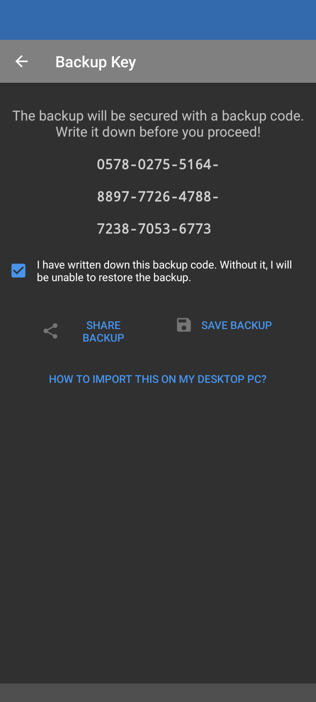</td>
    <td>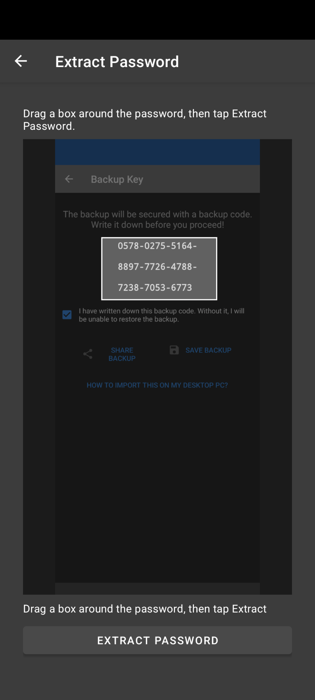</td>
    <td>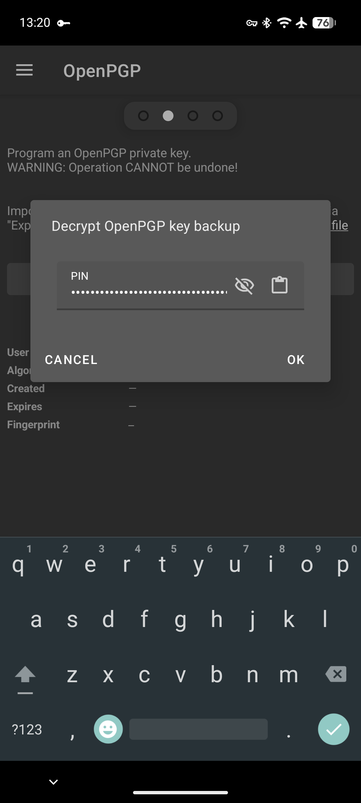</td>
  </tr>
</table>

> **Note:** *sub rosa* is not affiliated with OpenKeychain—we are simply big fans of OpenKeychain!

# How to import OpenPGP keys from PGPony

Similarly to OpenKeychain, PGPony manages OpenPGP keys, handling generation, secure storage, and backups.

Importing keys from PGPony is even easier. Share a key backup with *sub rosa* and hit "WRITE OPENPGP KEY".
That's all. 

<table>
  <tr>
    <td>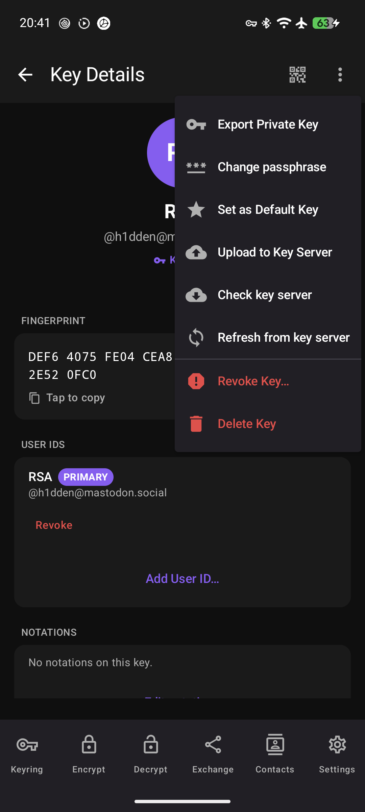</td>
    <td>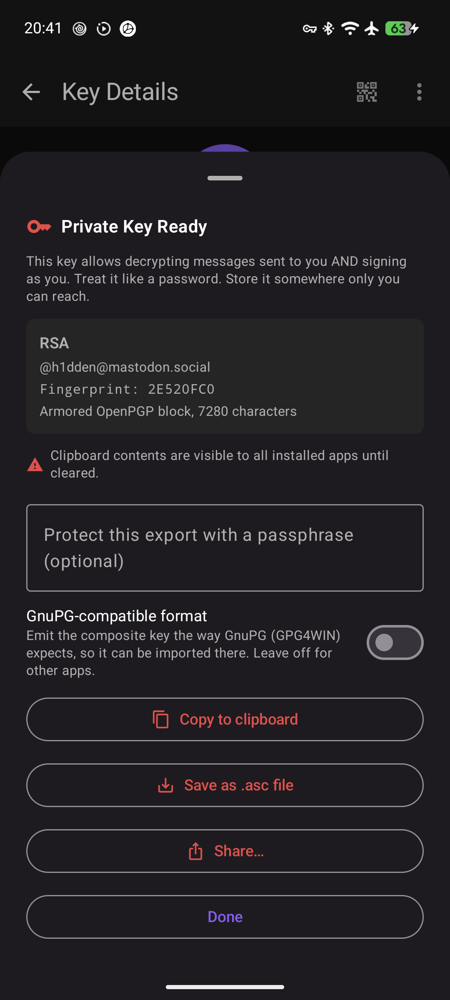</td>
    <td>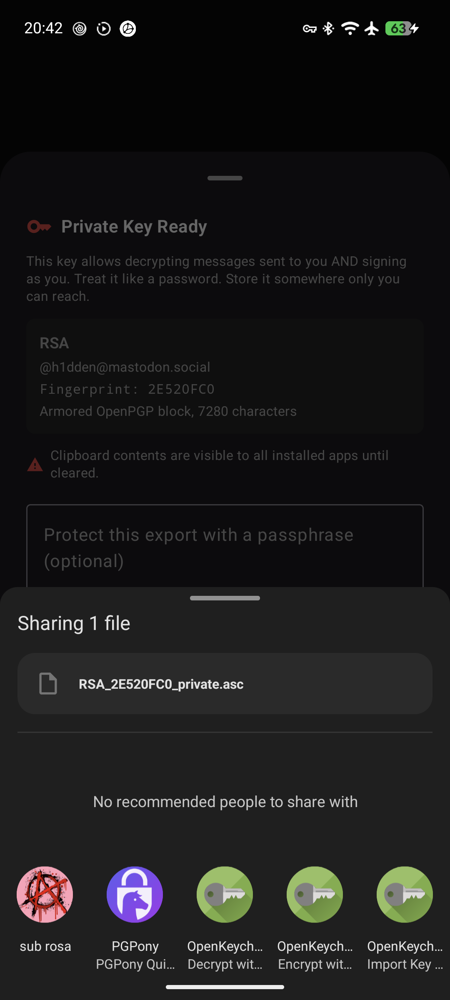</td>
  </tr>
</table>

> **Note:** *sub rosa* is not affiliated with PGPony—we are supporting PGPony, just like OpenKeychain!


# How to use your security key for SSH authentication

When generating a new OpenPGP key with OpenKeychain, select **Change key configuration** and add an **Authentication** subkey. Then import this OpenPGP key into *sub rosa* and write it to your security key.

On a clean Debian machine, ensure all required packages are installed:

```bash
sudo apt update
sudo apt install openssh-client gnupg scdaemon pinentry-curses pcscd
```

Identify where `pinentry` is installed:

```bash
which pinentry
```

The output should look similar to:

```
/usr/bin/pinentry
```

Take note of that path, then configure `gpg-agent` to enable SSH support and use that `pinentry` binary:

```bash
echo "enable-ssh-support" > ~/.gnupg/gpg-agent.conf
echo "pinentry-program /usr/bin/pinentry" >> ~/.gnupg/gpg-agent.conf
```

Restart the agent to apply the configuration:

```bash
gpgconf --kill gpg-agent
gpgconf --launch gpg-agent
gpgconf --list-dirs agent-ssh-socket
```

This should output a path like:

```
/run/user/1000/gnupg/S.gpg-agent.ssh
```

Note this path and add it to your `~/.ssh/config`:

```bash
echo "Host *" > ~/.ssh/config
echo "  IdentityAgent /run/user/1000/gnupg/S.gpg-agent.ssh" >> ~/.ssh/config
```

> **Note:** Be sure to replace `/run/user/1000/gnupg/S.gpg-agent.ssh` with the actual path output on your system.

Now query the security key:

```bash
gpg-connect-agent "scd learn --force" /bye
```

This displays details of the OpenPGP key written to your security key. The output will look similar to:

```
...
S KEYPAIRINFO 5BBF795A5F93498C2FF6C6CD3ABF896302DC9FA0 OPENPGP.1 sc 1782525925 ed25519
S KEYPAIRINFO D1B359A6A77A68B1776ABFA085E65AFA1582E6D6 OPENPGP.2 e 1782525925 cv25519
S KEYPAIRINFO 36F40BE75662CEA929402AAA360A64F448E35ABB OPENPGP.3 a 1782525925 ed25519
OK
```

To configure SSH to use the authentication key, add its keygrip to `~/.gnupg/sshcontrol`:

```bash
echo "36F40BE75662CEA929402AAA360A64F448E35ABB" >> ~/.gnupg/sshcontrol
gpgconf --kill gpg-agent
export SSH_AUTH_SOCK=$(gpgconf --list-dirs agent-ssh-socket)
ssh-add -L
```

> **Note:** Replace `36F40BE75662CEA929402AAA360A64F448E35ABB` with the keygrip of your specific Authentication subkey (the line ending in `a`).

The `ssh-add -L` command should display your public key card identifier, for example:

```
ssh-ed25519 AAAAC3NzaC1lZDI1NTE5AAAAIGfZlzyF4mwdtAnUNJVz1TxOkotdHNizIaA56IOepfA/ cardno:000F_D52FD320
```

Copy this line and add it to `~/.ssh/authorized_keys` on your remote server.

When logging into your remote server via SSH, you will be prompted for a PIN. This is the **User PIN** (default: `123456`), not the Admin PIN (default: `12345678`).

> **Note:** If any of the above instructions are incomplete or need updating, please feel free to open an issue or pull request to contribute to the project!

# Nitrokey 3 firmware update

Since version 3.0.0 *sub rosa* can update the firmware of Nitrokey 3 devices. Well, some Nitrokey 3 devices... 
Only those using LCP55 hardware: 3A and 3C. Extensive tests were performed with Nitrokey 3C NFC.

Nitrokey 3A mini use nRF52 hardware and are not supported by *sub rosa*. Yet

<table>
  <tr>
    <td>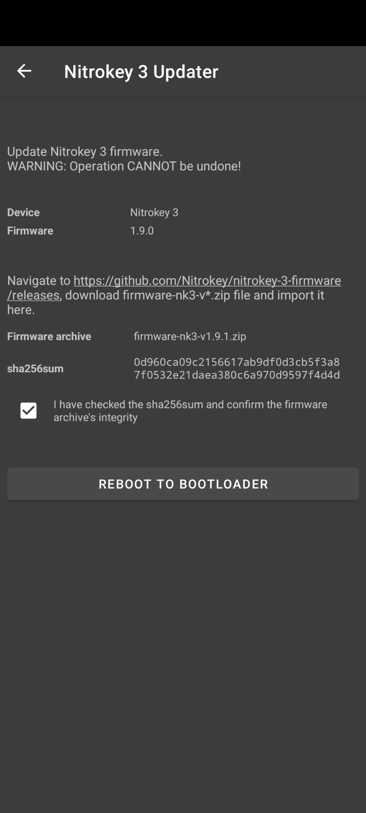</td>
    <td>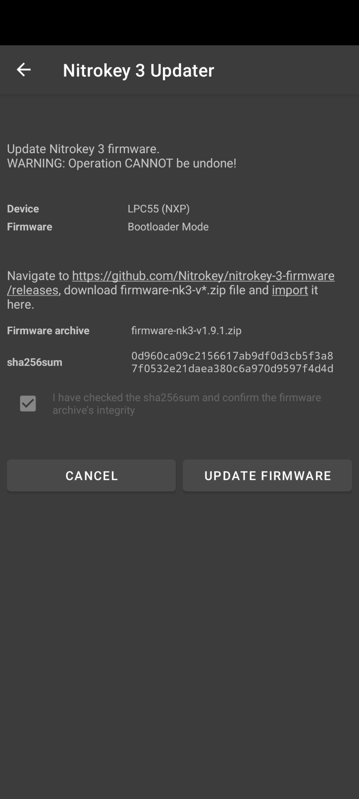</td>
    <td>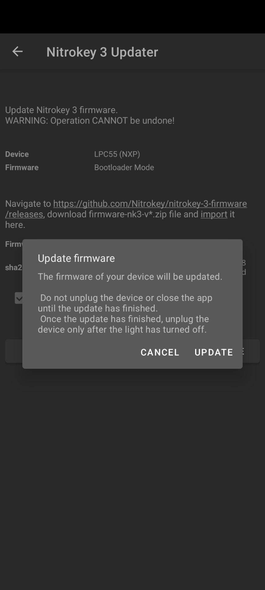</td>
  </tr>
</table>

Coffee tips can be sent to: `1HwgShr1TniuBxNQwy2xAhpQaNuZhtw6sh`

<table>
  <tr>
    <td></td>
    <td>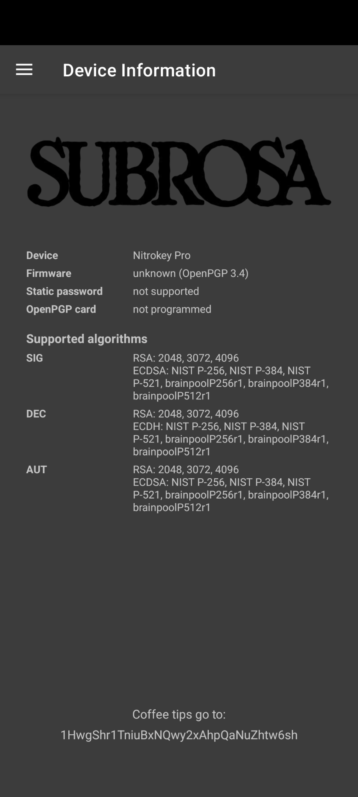</td>
    <td>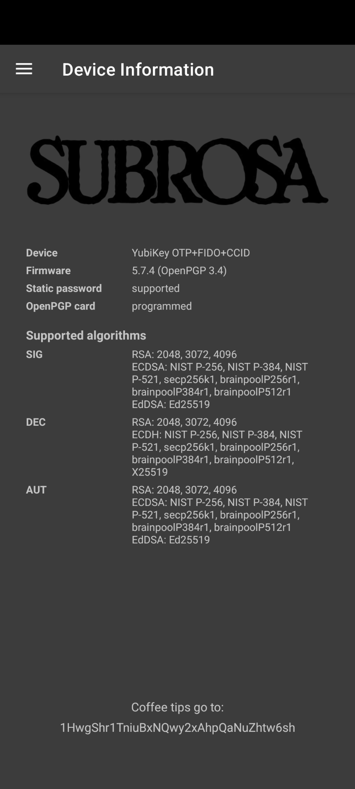</td>
  </tr>
  <tr>
    <td>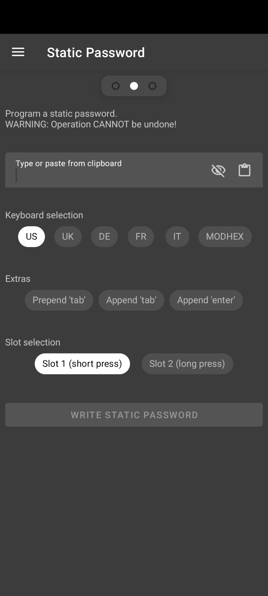</td>
    <td>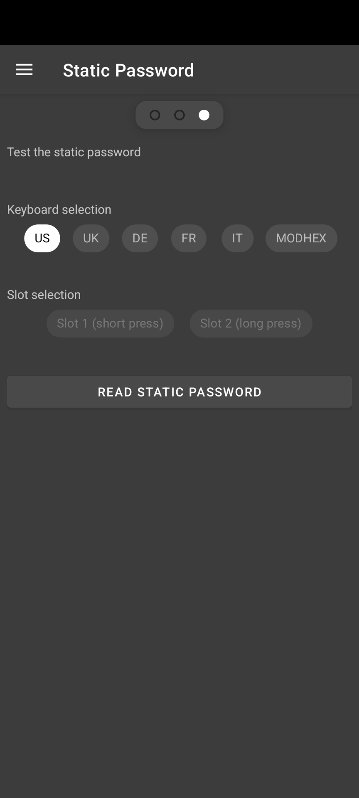</td>
    <td>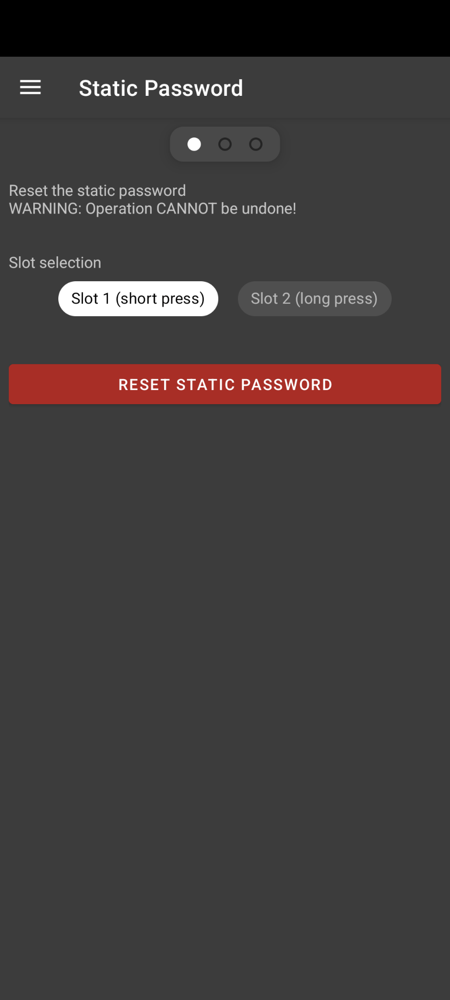</td>
  </tr>
  <tr>
    <td>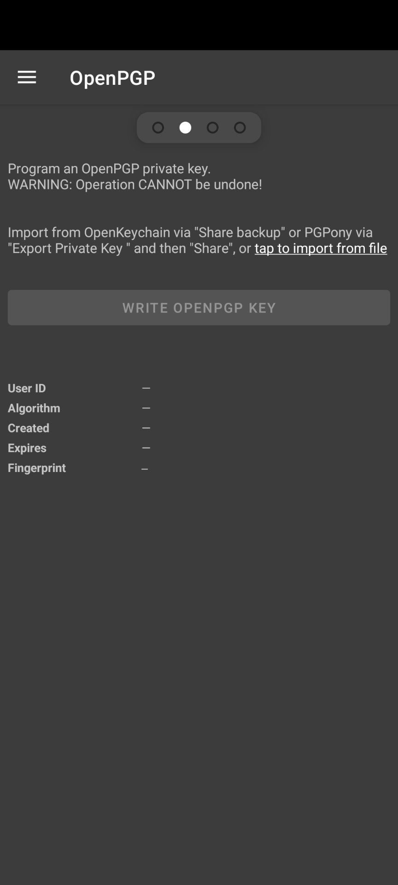</td>
    <td>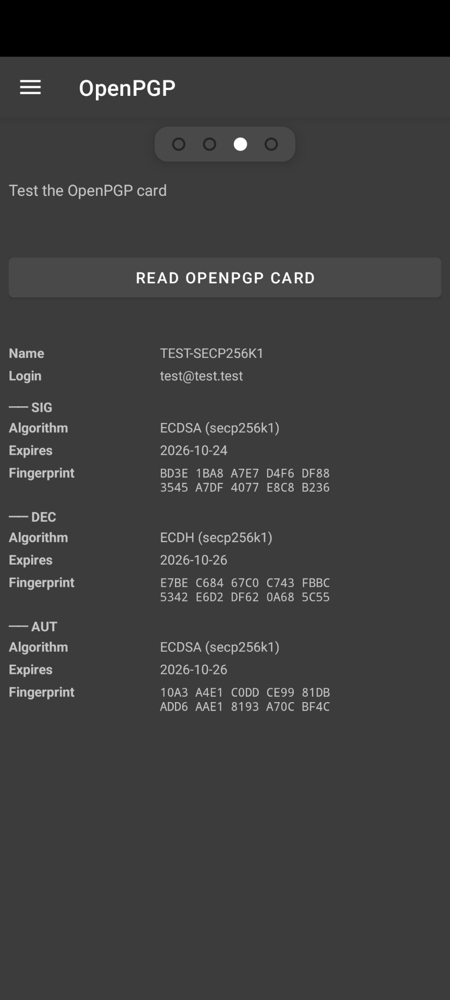</td>
    <td>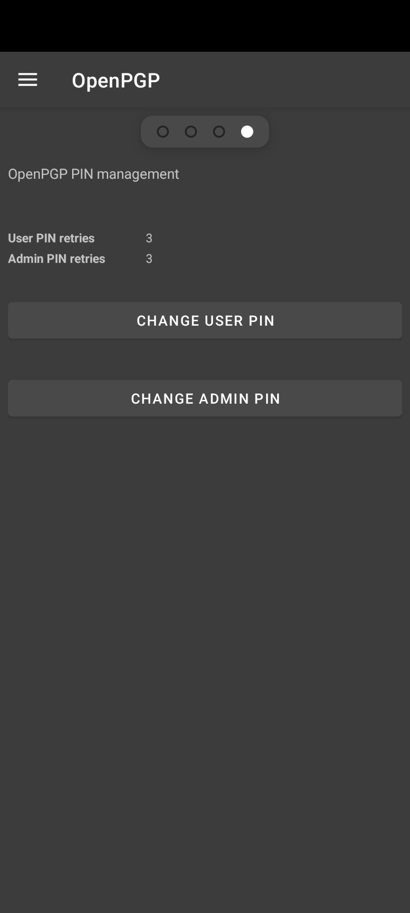</td>
  </tr>
  <tr>
    <td>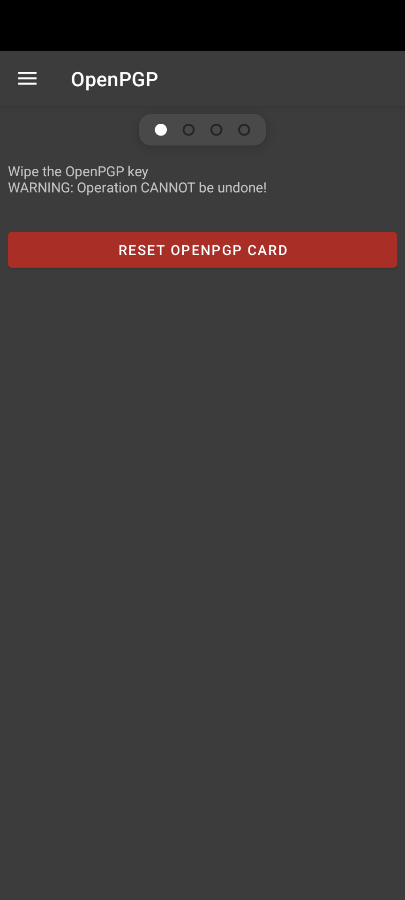</td>
    <td>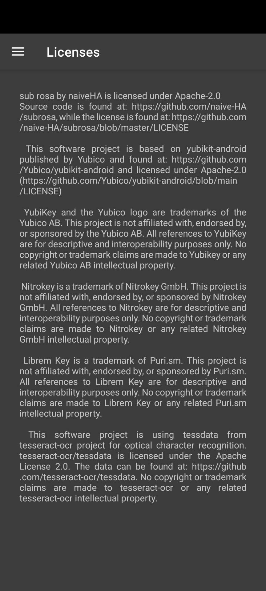</td>
    <td>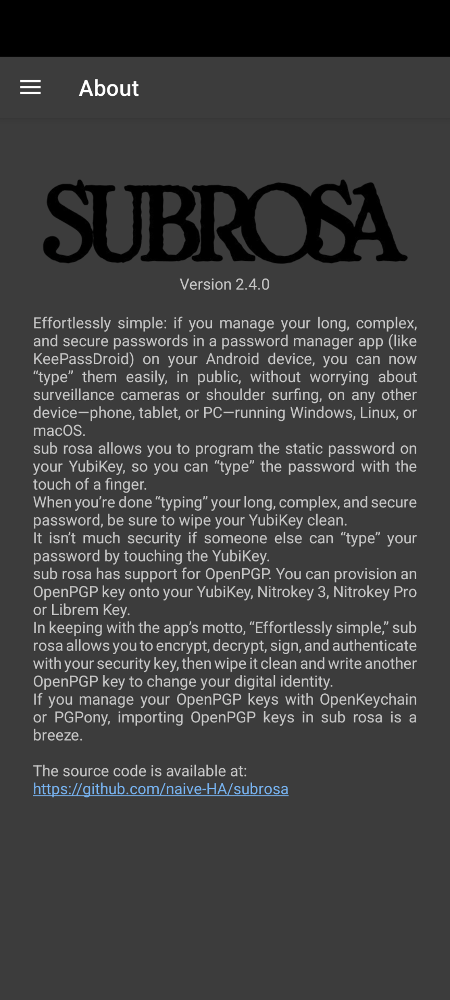</td>
  </tr>
</table>
