[](https://play.google.com/store/apps/details?id=acab.naiveha.subrosa.by.naiveha)
[](https://apt.izzysoft.de/packages/acab.naiveha.subrosa)

# sub rosa by naiveHA

"What does this app do?" Well, actually, the first question to ask is "why?" Why is there a need for this app? The answer is "passwords."

We all have a "password problem." The IT industry has been trying to solve the "password problem" for a long time.
Passwords are the weakest link in a digital security model.

Life is complicated enough without overloading your mind trying to remember long, complex passwords.
On top of that, good security hygiene requires changing passwords frequently. Add to that your personal email, social media, banking accounts, etc. 
You should use unique passwords for each account so that when (not if) one account is compromised, the attacker does not gain access to all your accounts. You get the point.

How many complex passwords (between 8 and 16 characters, including special characters like `~!@#$%^&*(){}:"<>?/.,';][=-`) can you memorize?
One solution is to use a password manager app (like KeePassDroid) on your phone.
But what if you use a work laptop, personal computer, tablet, or a second phone?
And the passwords still need to be changed periodically for security...
How do you stay safe online and still log into your accounts on other devices when your passwords are stored on your mobile phone?
How do you type your passwords while enjoying coffee at your local cafe without worrying about surveillance cameras or shoulder surfers?

Introducing **sub rosa**. Effortlessly simple.

*sub rosa* allows you to program a static password onto a hardware security key, which can act as a keyboard when touched. 
Plug it into your phone, tablet, or laptop, touch it, and it automatically types out a sequence of characters.

Simple: no need to memorize multiple complex passwords. No need to carry multiple devices either — you can program a hardware security key with a password, 
use it, and then program it with a different password whenever needed. Nowadays, hardware security keys come in various form factors: 
from models small enough to remain in your phone's USB-C port to larger, NFC-enabled keys.

*sub rosa* supports various keyboard layouts capable of typing the following character sets:

* **US**: space, `\n`, `\t` and `abcdefghijklmnopqrstuvwxyzABCDEFGHIJKLMNOPQRSTUVWXYZ0123456789!"#$%&'`()*+-=,./:;<>?@\\][^_{}|~`

* **UK**: space, `\n`, `\t` and `abcdefghijklmnopqrstuvwxyzABCDEFGHIJKLMNOPQRSTUVWXYZ0123456789!@£$%&'`()*+-=,./:;<>?"#][^_{}~¬`

* **DE**: space, `\n`, `\t` and `abcdefghijklmnopqrstuvwxyzABCDEFGHIJKLMNOPQRSTUVWXYZ0123456789!"#$%&'()*+-=,./:;<>?^_`§´ÄÖÜßäöü`

* **FR**: space, `\n`, `\t` and `abcdefghijklmnopqrstuvwxyzABCDEFGHIJKLMNOPQRSTUVWXYZ0123456789!"$%&'()*+-=,./:;<_£§°²µàçèéù`

* **IT**: space, `\n`, `\t` and `abcdefghijklmnopqrstuvwxyzABCDEFGHIJKLMNOPQRSTUVWXYZ0123456789!"#$%&'()*+,-./:;<=>?@\^_`|£§°çèéàìòù`

* **MODHEX**: `bcdefghijklnrtuvBCDEFGHIJKLNRTUV`

Hardware security keys solve one part of the "password problem": you no longer need to memorize passwords, 
and you can log into your accounts across multiple devices while the password stays safe on your phone (protected by a PIN, passphrase, or fingerprint).

However, if you lose your hardware security key, anyone who finds it could touch it and output your password. 
Not much security if anyone can plug in your device and read your last programmed password.

No worries, *sub rosa* helps with this too: once you finish typing your complex password with your hardware security key, 
you can de-program (wipe) the device. If you lose the key later, your security remains uncompromised. Simple.

Hardware security keys (like, YubiKey, Nitrokey or Librem Key) can do much more than act as USB keyboards.
*sub rosa* can program an OpenPGP key onto your hardware key, allowing you to encrypt, decrypt, cryptographically sign documents, 
or authenticate to remote servers via SSH.
An OpenPGP key acts as your digital identity.

Digital signatures are officially recognized in many countries and are legally binding.
However, any digital system can potentially be compromised. It is not a question of *if*, but *when*.
Just like with passwords, you should keep your digital personas compartmentalized.

*sub rosa* comes to the rescue again: you can program an OpenPGP key onto your hardware security key, sign an electronic document, 
and then program a different OpenPGP key to decrypt a confidential message from a business partner or encrypt a whistleblower report sent to a news organization. 
Once finished, you can simply erase everything from the hardware security key so that losing the physical device never compromises your digital identity.

Just like KeePassDroid managing passwords, OpenKeychain or PGPony manage OpenPGP keys.
You can easily import OpenPGP keys generated or stored by these apps in *sub rosa* and then program them onto your hardware security key. 

*sub rosa* has its roots in the YubiKit library provided by Yubico

# How does *sub rosa* support various hardware security keys?

<table>
	<tr>
		<td height="34"><br></td>
		<td></td>
		<td colspan="2" align="center">YubiKey</td>
		<td colspan="2" align="center">Nitrokey 3</td>
        <td align="center">Nitrokey 2 Pro</td>
        <td align="center">Nitrokey Storage</td>
        <td align="center">Librem Key</td>
	</tr>
	<tr>
		<td></td>
		<td></td>
		<td align="center">USB</td>
		<td align="center">NFC</td>
		<td align="center">USB</td>
		<td align="center">NFC</td>
        <td align="center">USB</td>
        <td align="center">USB</td>
        <td align="center">USB</td>
	</tr>
	<tr>
		<td align="center">Static password</td>
		<td align="center">Write</td>
		<td align="center">✅</td>
		<td align="center">✅</td>
		<td align="center">❌</td>
		<td align="center">❌</td>
        <td align="center">❌</td>
        <td align="center">❌</td>
        <td align="center">❌</td>
	</tr>
	<tr>
		<td align="center"></td>
		<td align="center">Read</td>
		<td align="center">✅</td>
		<td align="center">✅</td>
		<td align="center">❌</td>
		<td align="center">❌</td>
        <td align="center">❌</td>
        <td align="center">❌</td>
        <td align="center">❌</td>
	</tr>
	<tr>
		<td align="center"></td>
		<td align="center">Wipe</td>
		<td align="center">✅</td>
		<td align="center">✅</td>
		<td align="center">❌</td>
		<td align="center">❌</td>
        <td align="center">❌</td>
        <td align="center">❌</td>
        <td align="center">❌</td>
	</tr>
	<tr>
		<td align="center">OpenPGP</td>
		<td align="center">Write</td>
		<td align="center">✅</td>
		<td align="center">✅</td>
		<td align="center">✅</td>
		<td align="center">❌</td>
        <td align="center">✅</td>
        <td align="center">✅</td>
        <td align="center">✅</td>
	</tr>
	<tr>
		<td align="center"></td>
		<td align="center">Read</td>
		<td align="center">✅</td>
		<td align="center">✅</td>
		<td align="center">✅</td>
		<td align="center">❌</td>
        <td align="center">✅</td>
        <td align="center">✅</td>
        <td align="center">✅</td>
	</tr>
	<tr>
		<td align="center"></td>
		<td align="center">Wipe</td>
		<td align="center">✅</td>
		<td align="center">✅</td>
		<td align="center">✅</td>
		<td align="center">❌</td>
        <td align="center">✅</td>
        <td align="center">✅</td>
        <td align="center">✅</td>
	</tr>
	<tr>
		<td align="center"></td>
		<td align="center">Change User PIN</td>
		<td align="center">✅</td>
		<td align="center">✅</td>
		<td align="center">✅</td>
		<td align="center">❌</td>
        <td align="center">✅</td>
        <td align="center">✅</td>
        <td align="center">✅</td>
	</tr>
	<tr>
		<td align="center"></td>
		<td align="center">Reset User PIN</td>
		<td align="center">✅</td>
		<td align="center">✅</td>
		<td align="center">✅</td>
		<td align="center">❌</td>
        <td align="center">✅</td>
        <td align="center">✅</td>
        <td align="center">✅</td>
	</tr>
	<tr>
		<td align="center"></td>
		<td align="center">Change Admin PIN</td>
		<td align="center">✅</td>
		<td align="center">✅</td>
		<td align="center">✅</td>
		<td align="center">❌</td>
        <td align="center">✅</td>
        <td align="center">✅</td>
        <td align="center">✅</td>
	</tr>
</table>

<table>
    <tr> 
        <td>Supported cryptographic algorithms</td> 
        <td align="center">YubiKey</td> 
        <td align="center">Nitrokey 3</td> 
        <td align="center">Nitrokey 2 Pro</td> 
        <td align="center">Nitrokey Storage</td>
        <td align="center">Librem Key</td> 
    </tr>
    <tr> 
        <td>RSA 2048</td> 
        <td align="center">✅</td> 
        <td align="center">✅</td> 
        <td align="center">✅</td> 
        <td align="center">✅</td>
        <td align="center">✅</td> 
    </tr> 
    <tr> 
        <td>RSA 3072</td> 
        <td align="center">✅</td> 
        <td align="center">✅</td> 
        <td align="center">✅</td> 
        <td align="center">✅</td> 
        <td align="center">✅</td> 
    </tr> 
    <tr> 
        <td>RSA 4096</td>
        <td align="center">✅</td>
        <td align="center">✅</td>   
        <td align="center">✅</td>
        <td align="center">✅</td> 
        <td align="center">✅</td>
    </tr>
    <tr>
        <td>ECC / NIST P-256</td>
        <td align="center">✅</td>
        <td align="center">✅</td>
        <td align="center">✅</td>
        <td align="center">✅</td>
        <td align="center">✅</td> 
    </tr>
    <tr>
        <td>ECC / NIST P-384</td>
        <td align="center">✅</td>
        <td align="center">✅</td>
        <td align="center">✅</td>
        <td align="center">✅</td>
        <td align="center">✅</td> 
    </tr>
    <tr>
        <td>ECC / NIST P-521</td>
        <td align="center">✅</td>
        <td align="center">✅</td>
        <td align="center">✅</td>
        <td align="center">✅</td>
        <td align="center">✅</td> 
    </tr>
    <tr>
        <td>ECC / brainpoolP256r1</td>
        <td align="center">✅</td>
        <td align="center">✅</td>
        <td align="center">✅</td>
        <td align="center">✅</td>
        <td align="center">✅</td> 
    </tr>
    <tr>
        <td>ECC / brainpoolP384r1</td>
        <td align="center">✅</td>
        <td align="center">✅</td>
        <td align="center">✅</td>
        <td align="center">✅</td>
        <td align="center">✅</td> 
    </tr>
    <tr>
        <td>ECC / brainpoolP512r1</td>
        <td align="center">✅</td>
        <td align="center">✅</td>
        <td align="center">✅</td>
        <td align="center">✅</td>
        <td align="center">✅</td> 
    </tr>
    <tr>
        <td>ECC / Ed25519/X25519</td>
        <td align="center">✅</td>
        <td align="center">✅</td>
        <td align="center">❌</td>
        <td align="center">❌</td>
        <td align="center">❌</td>
    </tr>
    <tr>
        <td>ECC / secp256k1</td>
        <td align="center">✅</td>
        <td align="center">✅</td>
        <td align="center">❌</td>
        <td align="center">❌</td>
        <td align="center">❌</td>
    </tr>
</table>

# How to import OpenPGP keys from OpenKeychain

*sub rosa* works closely with OpenKeychain. OpenKeychain manages OpenPGP keys, handling generation, secure storage, and backups. 

Importing keys from OpenKeychain is a breeze. Share a key backup with *sub rosa* and enter the backup code provided by OpenKeychain. 
Because this backup code—consisting of 36 numbers and dashes—cannot be copied directly to the clipboard from OpenKeychain, *sub rosa* includes Tesseract (an Optical Character Recognition library) to make the process effortless:

1. Take a screenshot of the OpenKeychain app displaying the backup code and share that screenshot with *sub rosa*.
2. Select the region containing the backup code and tap **EXTRACT PASSWORD**.
3. The backup code will be copied to your clipboard. Return to OpenKeychain and tap **SHARE BACKUP**.
4. Paste the backup code into *sub rosa* and get ready to write your private OpenPGP key to your security key.

<table>
  <tr>
    <td>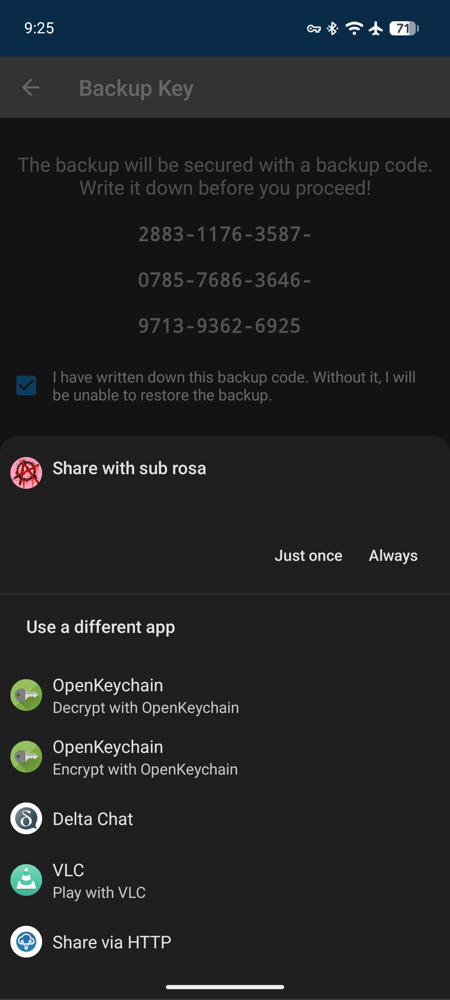</td>
    <td>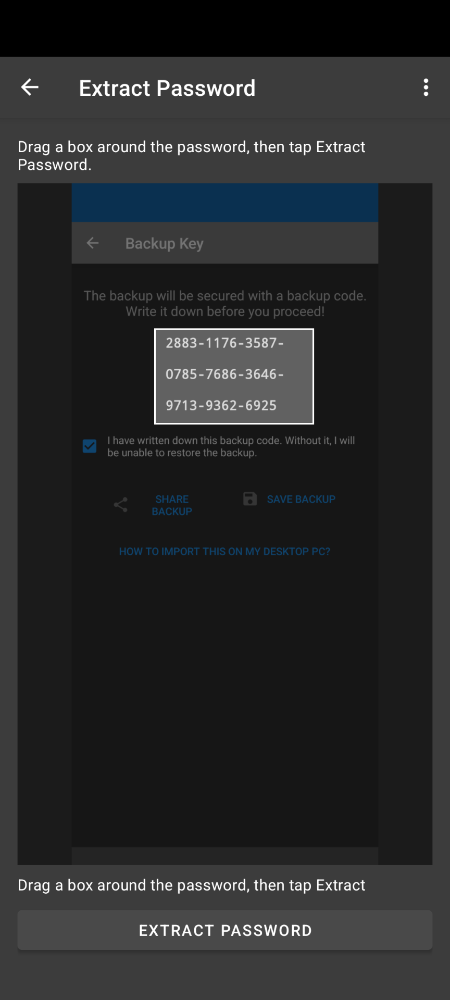</td>
    <td>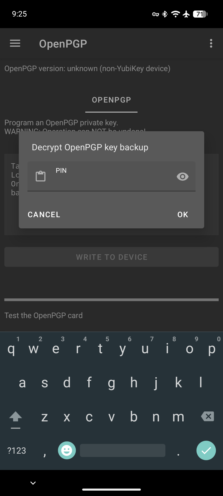</td>
  </tr>
</table>

> **Note:** *sub rosa* is not affiliated with OpenKeychain—we are simply big fans of OpenKeychain!

# How to import OpenPGP keys from PGPony

Similarly to OpenKeychain, PGPony manages OpenPGP keys, handling generation, secure storage, and backups.

Importing keys from PGPony is even easier. Share a key backup with *sub rosa* and hit "WRITE OPENPGP KEY".
That's all. 

<table>
  <tr>
    <td>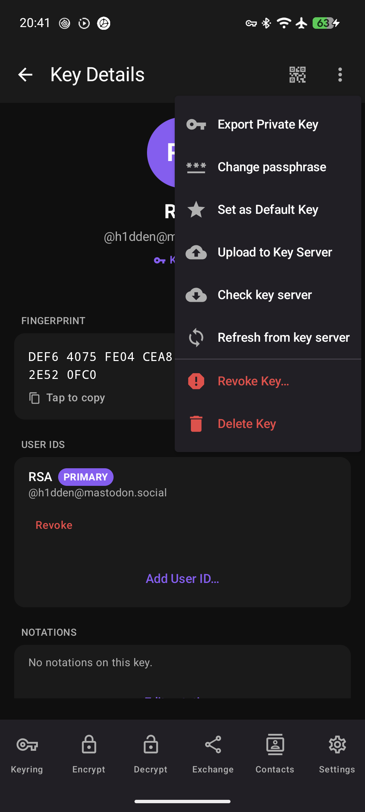</td>
    <td>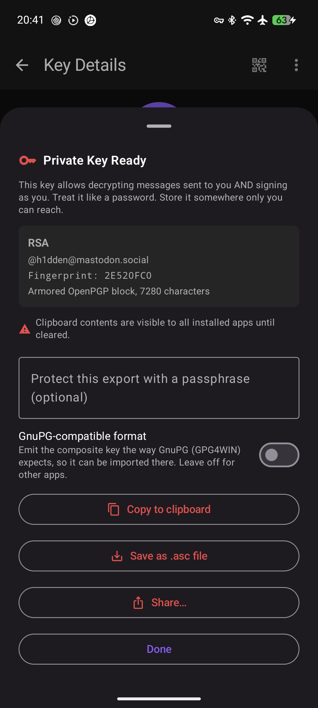</td>
    <td>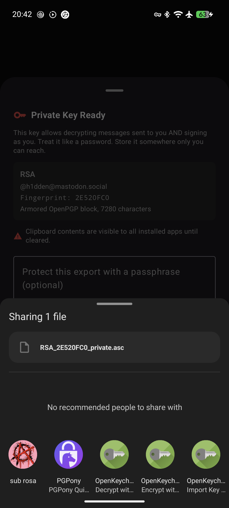</td>
  </tr>
</table>

> **Note:** *sub rosa* is not affiliated with PGPony—we are supporting PGPony, just like OpenKeychain!


# How to use your security key for SSH authentication

When generating a new OpenPGP key with OpenKeychain, select **Change key configuration** and add an **Authentication** subkey. Then import this OpenPGP key into *sub rosa* and write it to your security key.

On a clean Debian machine, ensure all required packages are installed:

```bash
sudo apt update
sudo apt install openssh-client gnupg scdaemon pinentry-curses pcscd
```

Identify where `pinentry` is installed:

```bash
which pinentry
```

The output should look similar to:

```
/usr/bin/pinentry
```

Take note of that path, then configure `gpg-agent` to enable SSH support and use that `pinentry` binary:

```bash
echo "enable-ssh-support" > ~/.gnupg/gpg-agent.conf
echo "pinentry-program /usr/bin/pinentry" >> ~/.gnupg/gpg-agent.conf
```

Restart the agent to apply the configuration:

```bash
gpgconf --kill gpg-agent
gpgconf --launch gpg-agent
gpgconf --list-dirs agent-ssh-socket
```

This should output a path like:

```
/run/user/1000/gnupg/S.gpg-agent.ssh
```

Note this path and add it to your `~/.ssh/config`:

```bash
echo "Host *" > ~/.ssh/config
echo "  IdentityAgent /run/user/1000/gnupg/S.gpg-agent.ssh" >> ~/.ssh/config
```

> **Note:** Be sure to replace `/run/user/1000/gnupg/S.gpg-agent.ssh` with the actual path output on your system.

Now query the security key:

```bash
gpg-connect-agent "scd learn --force" /bye
```

This displays details of the OpenPGP key written to your security key. The output will look similar to:

```
...
S KEYPAIRINFO 5BBF795A5F93498C2FF6C6CD3ABF896302DC9FA0 OPENPGP.1 sc 1782525925 ed25519
S KEYPAIRINFO D1B359A6A77A68B1776ABFA085E65AFA1582E6D6 OPENPGP.2 e 1782525925 cv25519
S KEYPAIRINFO 36F40BE75662CEA929402AAA360A64F448E35ABB OPENPGP.3 a 1782525925 ed25519
OK
```

To configure SSH to use the authentication key, add its keygrip to `~/.gnupg/sshcontrol`:

```bash
echo "36F40BE75662CEA929402AAA360A64F448E35ABB" >> ~/.gnupg/sshcontrol
gpgconf --kill gpg-agent
export SSH_AUTH_SOCK=$(gpgconf --list-dirs agent-ssh-socket)
ssh-add -L
```

> **Note:** Replace `36F40BE75662CEA929402AAA360A64F448E35ABB` with the keygrip of your specific Authentication subkey (the line ending in `a`).

The `ssh-add -L` command should display your public key card identifier, for example:

```
ssh-ed25519 AAAAC3NzaC1lZDI1NTE5AAAAIGfZlzyF4mwdtAnUNJVz1TxOkotdHNizIaA56IOepfA/ cardno:000F_D52FD320
```

Copy this line and add it to `~/.ssh/authorized_keys` on your remote server.

When logging into your remote server via SSH, you will be prompted for a PIN. This is the **User PIN** (default: `123456`), not the Admin PIN (default: `12345678`).

> **Note:** If any of the above instructions are incomplete or need updating, please feel free to open an issue or pull request to contribute to the project!

Coffee tips can be sent to: `1HwgShr1TniuBxNQwy2xAhpQaNuZhtw6sh`

<table>
  <tr>
    <td>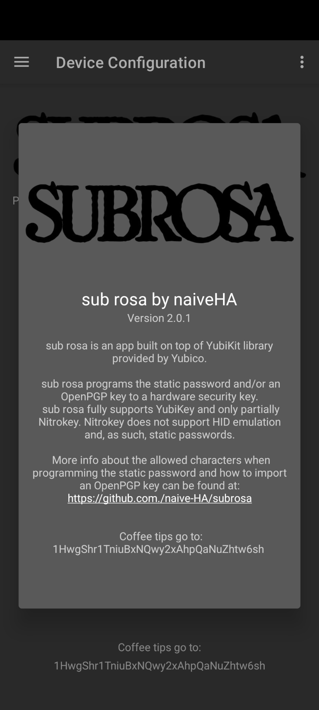</td>
    <td>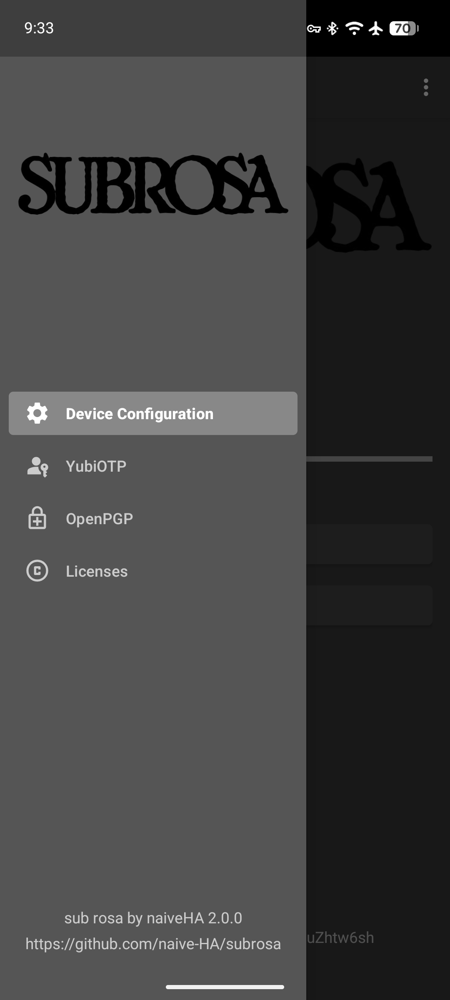</td>
    <td>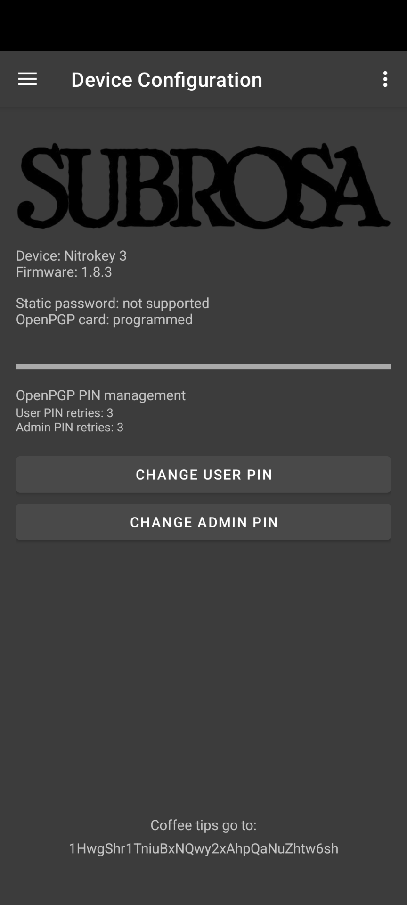</td>
  </tr>
  <tr>
    <td>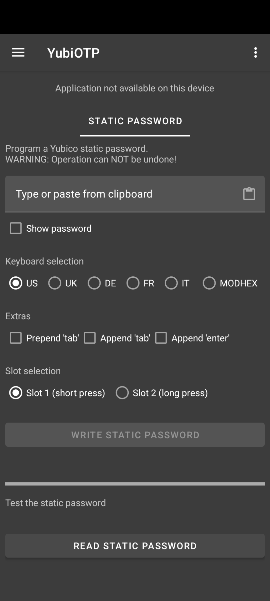</td>
    <td>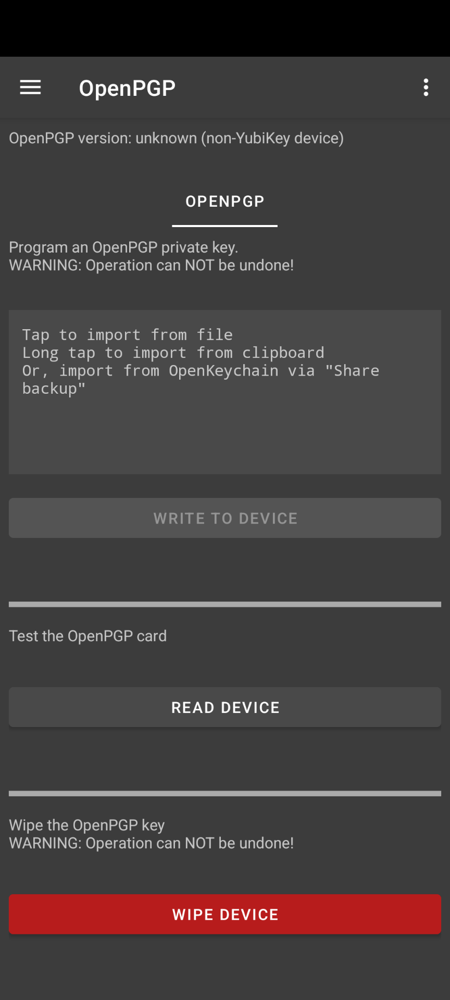</td>
    <td>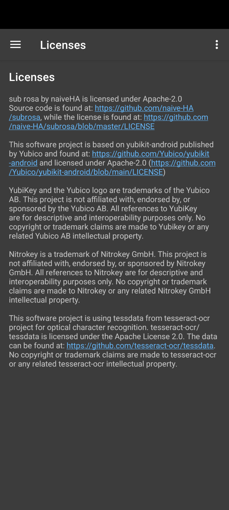</td>
  </tr>
</table>
